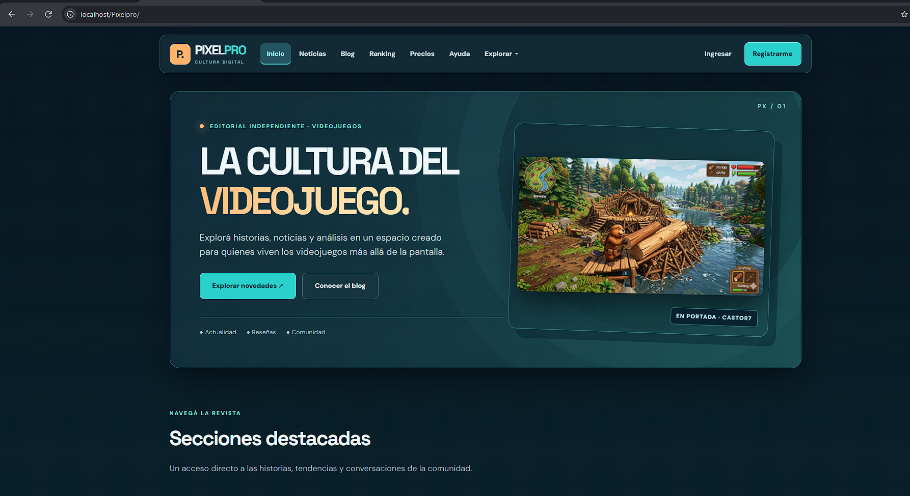
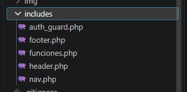
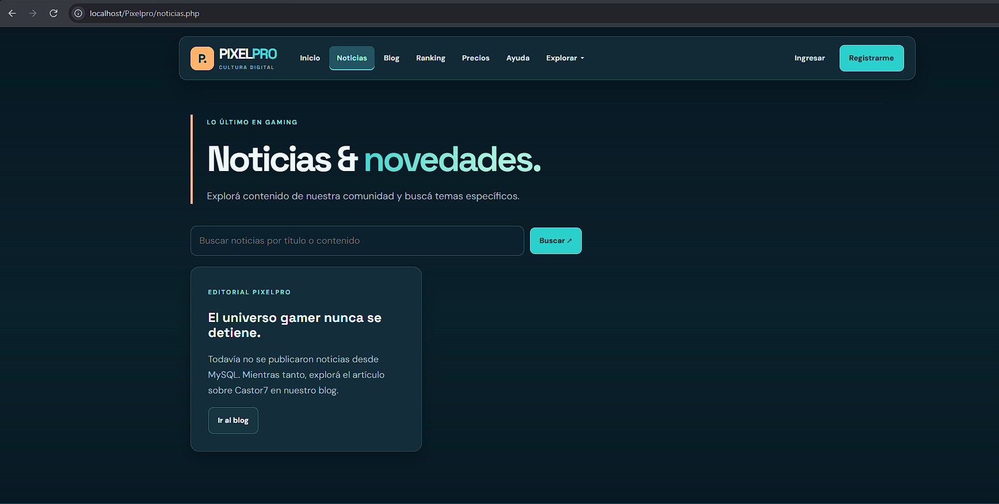

# PixelPro — TP4

**Proyecto:** Portal gamer PixelPro · Integrador de Programación Web TP4–TP8.

**Instalación previa:** colocar `PixelPro/` en `C:\xampp\htdocs\`, encender Apache y MySQL, importar `PixelPro/database/schema.sql` en phpMyAdmin y configurar `PixelPro/config/.env` a partir de `.env.example` sin compartir las credenciales. Abrir `http://localhost/PixelPro/`.

## Objetivo

Migrar el sitio a PHP, reutilizar partes comunes y separar estructura, diseño e interactividad.

## Implementación

- `index.php`: portada principal de PixelPro.
- `includes/header.php` y `includes/footer.php`: elementos compartidos entre páginas.
- `includes/nav.php`: navegación reutilizable.
- `todo.css` y `todo.js`: estilos y comportamientos separados del PHP.
- `config/env.php`: lectura de configuración.

### Portada principal de PixelPro

### Archivos compartidos PHP

### Navegación entre páginas

